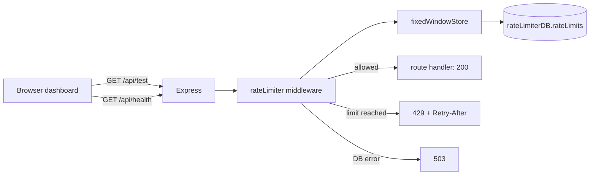

# MongoDB API Rate Limiter

Fixed Window Counter rate limiter. Node.js, Express, MongoDB (Mongoose). Default: **5 requests per 60 seconds per client IP**.
The dashboard (`frontend/`) is a retro-desktop UI that talks to the real API.

## Structure

    backend/
      src/config/        env config + MongoDB connection (db.js)
      src/models/        RateLimit schema + indexes
      src/services/      fixedWindowStore.js  (all MongoDB logic)
      src/middleware/     rateLimiter.js       (HTTP logic: headers, 429, 503)
      src/routes/        /api/health, /api/test
      test/              unit tests (no database needed)
      scripts/           concurrency-check.js (needs running server + MongoDB)
    frontend/            index.html, css/, js/  (served by Express at /)

## Setup (Windows / macOS / Linux)

1. Start MongoDB Community Server locally (default `mongodb://127.0.0.1:27017`).
2. `cd backend`, then `npm install`
3. Copy `.env.example` to `.env` (never commit `.env`)
4. `npm start`, then open http://localhost:5000

Run `npm test` for unit tests. Config (`.env`): `PORT`, `MONGO_URI`, `RATE_LIMIT_MAX`, `RATE_LIMIT_WINDOW_MS`, `RATE_LIMIT_RETENTION_MS`, `TRUST_PROXY`, `CORS_ORIGIN`.

## Architecture

## Data model

One document per client per window (no per-request logs):

    { clientId: "::1", windowStart: ISODate, requestCount: 3, expiresAt: ISODate }

- Unique compound index `{ clientId: 1, windowStart: 1 }`
- TTL index `{ expiresAt: 1 }, expireAfterSeconds: 0`. MongoDB removes expired documents on its own (sweep runs about every 60 s; the logic never relies on it).

## How a request is counted

1. `windowStart = floor(now / window) * window` (epoch-aligned).
2. **Upsert** the window document with `requestCount: 0` (`$setOnInsert`). Duplicate-key error (E11000) from a simultaneous first request is ignored.
3. **Atomic conditional increment:** `findOneAndUpdate({ clientId, windowStart, requestCount: { $lt: max } }, { $inc: { requestCount: 1 } })`.
   Match: allowed. No match: limit reached, nothing is incremented, respond 429.
4. Any other database error: respond 503 (fail closed).

Known limitation of fixed windows: a client can send `max` requests at the end of one window and `max` at the start of the next. Window boundaries use the app server's clock.

## API

| Endpoint | Rate limited | Description |
|---|---|---|
| `GET /api/health` | no | Server status, DB state, limit config, and `client.used` for the caller (read-only) |
| `GET /api/test` | yes | Returns `{ success: true, message: "Request accepted successfully" }` |

| Status | Meaning |
|---|---|
| 200 | Request counted and served |
| 429 | Limit reached. Body has `retryAfter` (seconds) |
| 503 | MongoDB cannot enforce the limit |

Headers on `/api/test`: `RateLimit-Limit`, `RateLimit-Remaining`, `RateLimit-Reset` (seconds to window end); `Retry-After` on 429 only.

## Testing

- **Unit tests:** `npm run test:unit` runs the in-memory middleware unit test suite without needing a running database.
- **MongoDB concurrency integration test:** `npm run test:integration` (or `npm test`) tests simultaneous requests directly against MongoDB via `fixedWindowStore.consume`, proving atomic conditional increment and race safety against the real database.
- **Server concurrency test:** `npm run concurrency` sends 20 simultaneous HTTP requests against the live running server (`scripts/concurrency-check.js`).
- **Postman:** import `docs/postman_collection.json`, set `baseUrl`, send *Test* six times: 200 x5, then 429 with `Retry-After`. Wait for the window to end, send again: 200.

**MongoDB failure:** stop the MongoDB service, send *Test*: 503 (immediate, commands are not buffered). Start it again: the server reconnects within ~5 s.

**TTL / indexes** in mongosh:

    use rateLimiterDB
    db.rateLimits.getIndexes()          // unique + TTL (expireAfterSeconds: 0)
    db.rateLimits.find()                // one document per IP per window

